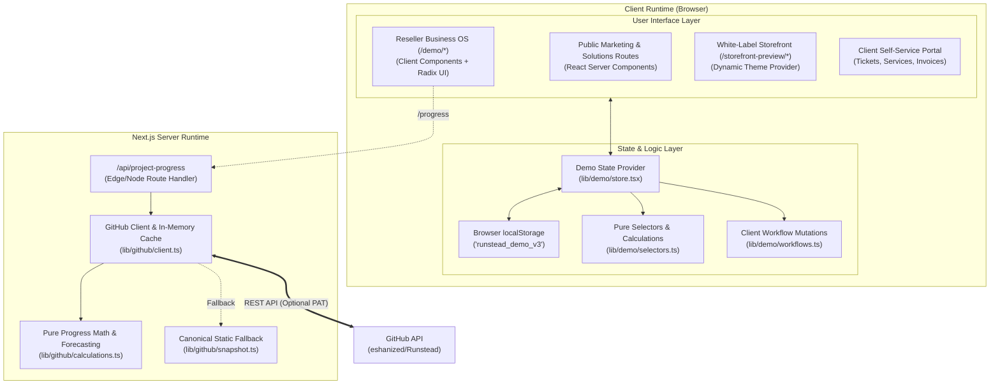
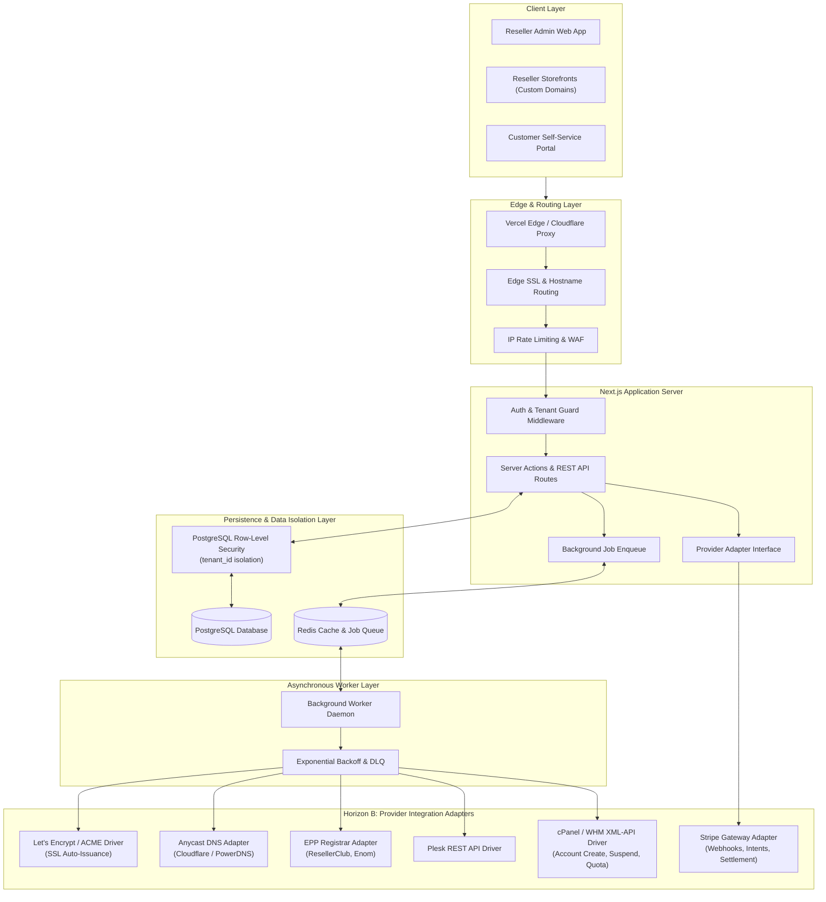

# Runstead — System Architecture & Design Baseline

> **Project Name**: Runstead  
> **Sponsoring Organization**: Tonmoy Infrastructure  
> **Status**: Authoritative Architectural Baseline (Phase 0)  
> **Document Scope**: Current Implementation vs. Target Production Architecture

---

## 1. Architectural Strategy & Philosophy

Runstead is engineered as a unified operating system for hosting businesses. To ensure maintainability, testability, and security across all phases of development, the architecture enforces a strict separation between:

1. **Current Implemented Architecture (Phase 0)**: A high-fidelity, type-safe Next.js application running client-side state persistence, RFC validation engines, and pure calculation modules.
2. **Target Production Architecture (Horizon A & B)**: A multi-tier cloud-native architecture incorporating server-side PostgreSQL with Row-Level Security, asynchronous job queues, and hardened provider integration adapters.

---

## 2. Current Architecture (Phase 0 Implemented Baseline)

In its current state, Runstead operates as a unified Next.js 14 application with client-side state simulation:



### Component Breakdown (Current Baseline)
- **Frontend / Rendering**: Next.js 14 App Router with React 18.2.0. Pages leverage React Server Components (RSC) where static content dominates (`/`, `/about`, `/security`, `/pricing`) and Client Components (`'use client'`) for interactive forms, modals, tables, and canvases.
- **State Management**: React Context (`lib/demo/store.tsx`) managing in-memory state initialized from deterministic seed fixtures (`lib/demo/seed-data.ts`).
- **Data Persistence**: Local storage key `runstead_demo_v3` with backwards-compatibility migration checks for legacy keys (`hostpilot_demo_v1..v3`, `runstead_demo_v1..v2`).
- **Business Workflow Execution**: Synchronous TypeScript action reducers (`lib/demo/workflows.ts`) performing client-side entity creation, state transitions, balance updates, and soft-archival.
- **Progress Telemetry Subsystem**: Fully production-ready server-side route handler (`app/api/project-progress/route.ts`) interfacing with GitHub REST API, featuring a 10-minute in-memory cache and a 42-task canonical static snapshot (`lib/github/snapshot.ts`).

---

## 3. Target Production Architecture (Horizon A & B)

The planned architecture for upcoming production phases introduces real persistence, authentication, background workers, and driver adapters:



---

## 4. Key Subsystem Architectural Specifications

### 4.1 Tenant-Aware Data Access & Row-Level Security (RLS) — Implemented (Phase 2)
- **Authoritative Database Schema**: Managed via Prisma ORM 6.12.0 (`prisma/schema.prisma`) with versioned migrations (`prisma/migrations/20261015081632_init_phase2_schema/migration.sql`).
- **Enforced Foreign Keys**: Every relational table (Customers, Products, Orders, Invoices, Services, Domains, Tickets, etc.) mandates a composite foreign key preventing cross-tenant relationships.
- **Engine-Level Row-Level Security**: All 18 tenant-owned tables enforce `ENABLE ROW LEVEL SECURITY` and `FORCE ROW LEVEL SECURITY`:
  ```sql
  ALTER TABLE customers ENABLE ROW LEVEL SECURITY;
  ALTER TABLE customers FORCE ROW LEVEL SECURITY;
  CREATE POLICY customers_tenant_isolation_policy ON customers
    FOR ALL
    USING (tenant_id = current_tenant_id())
    WITH CHECK (tenant_id = current_tenant_id());
  ```
- **Transaction-Scoped Tenant Context**: Executed via `withTenantContext(tenantId, async (tx) => { ... })` using parameterized `SELECT set_config('app.current_tenant_id', $1, true)`. The `is_local = true` parameter strictly scopes tenant identity to the active transaction, eliminating connection-pool leakage risks.
- **Unprivileged Role**: Runtime application queries operate under the restricted `runstead_app` role (`NOSUPERUSER`, `NOBYPASSRLS`).
- **Verified by Automated Integration Tests**: Validated by 25 automated PostgreSQL tests (`tests/db-rls.test.ts`).
- **Coexistence with Demo State**: Offline demonstration provider (`lib/demo/store.tsx`) remains functional for browser routes and E2E journeys without live database requirements.

### 4.2 Authentication & Authorization (RBAC)
- **Reseller Operators & Staff**: Authenticated via JWT or HTTP-only signed session cookies with BCrypt password hashing and MFA support. Staff members are mapped via `tenant_memberships` table associating their user identity with specific permissions (`admin`, `billing`, `support`, `viewer`).
- **End Customers**: Authenticated separately under tenant-scoped customer credentials. A customer belonging to Tenant A cannot authenticate against Tenant B's client portal.
- **Platform Operators**: Governed by an isolated `platform_superadmins` table granting read-only fleet inspection and platform-tier governance.

### 4.3 Asynchronous Job Execution & Provisioning Safety
- All operations that mutate external infrastructure (hosting account creation, DNS propagation, domain registration, SSL certificates) must execute asynchronously via persistent queues (e.g. BullMQ on Redis or PostgreSQL-backed jobs).
- Operations must adhere to **Idempotency Standards**:
  - Every job payload includes an `idempotency_key` (UUID v4).
  - External API calls record request payloads and response signatures in an `audit_events` ledger.
  - Failures trigger bounded exponential backoff retries (e.g., intervals of 30s, 2m, 10m, 1h) before transitioning to a `dead_letter` status requiring staff review.
  - Retries must never create duplicate accounts or charge customer cards multiple times.

### 4.4 Provider Adapter Abstraction
To avoid vendor lock-in and decouple core business logic from third-party vendor quirks, all external provider interactions are routed through abstract TypeScript interfaces:

```typescript
// Core Provisioning Driver Interface
export interface HostingProviderDriver {
  readonly providerId: string;
  createAccount(payload: CreateAccountPayload): Promise<DriverResult<ProvisionedService>>;
  suspendAccount(serviceId: string, reason: string): Promise<DriverResult<void>>;
  unsuspendAccount(serviceId: string): Promise<DriverResult<void>>;
  terminateAccount(serviceId: string): Promise<DriverResult<void>>;
  updateResourceLimits(serviceId: string, limits: ResourceLimits): Promise<DriverResult<void>>;
  getUsageMetrics(serviceId: string): Promise<DriverResult<UsageMetrics>>;
}

// Core Registrar Driver Interface
export interface DomainRegistrarDriver {
  readonly registrarId: string;
  checkAvailability(sld: string, tld: string): Promise<DriverResult<AvailabilityResult>>;
  registerDomain(payload: RegisterDomainPayload): Promise<DriverResult<RegisteredDomain>>;
  renewDomain(domainId: string, years: number): Promise<DriverResult<void>>;
  updateNameservers(domainId: string, nameservers: string[]): Promise<DriverResult<void>>;
}
```

---

## 5. Architectural Decision Records (ADR) Index

Detailed architectural evaluations are maintained under [`docs/adr/`](file:///docs/adr/):
- **ADR-0001**: [Next.js App Router & React 18 Framework Baseline](file:///docs/adr/0001-runtime-and-application-framework.md) — *Accepted*
- **ADR-0002**: [Client State Store & Future Database Persistence Strategy](file:///docs/adr/0002-state-management-and-persistence-strategy.md) — *Accepted*
- **ADR-0003**: [Multi-Tenant Data Isolation & RLS Boundary Model](file:///docs/adr/0003-multi-tenant-isolation-model.md) — *Accepted*
- **ADR-0004**: [Driver-Based Provider Adapter Architecture](file:///docs/adr/0004-provider-adapter-architecture.md) — *Accepted*
- **ADR-0005**: [32-Phase Roadmap Structure & Execution Governance](file:///docs/adr/0005-roadmap-structure-and-phase-governance.md) — *Proposed (Awaiting Approval)*
