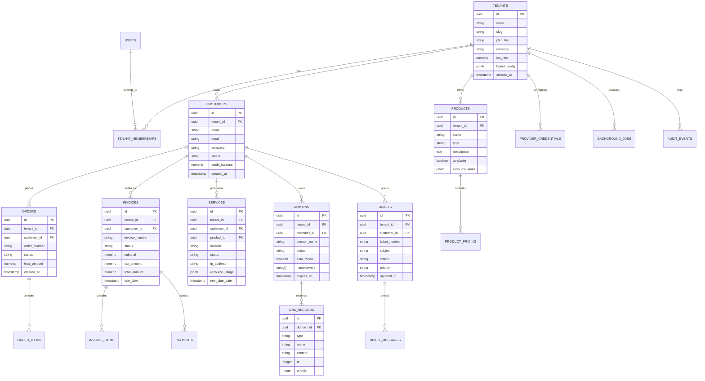

# Runstead — Data Model & Entity Specifications

> **Project Name**: Runstead  
> **Sponsoring Organization**: Tonmoy Infrastructure  
> **Document Baseline**: Phase 0 (October 2026)  
> **Scope**: Entity Specifications, Relational Integrity, Tenant Ownership, Current Demo Schema vs. Proposed Production Schema

---

## 1. Data Modeling Architecture

Runstead enforces strict relational data ownership centered on the **Tenant (Reseller Business Account)**.

All domain operations (orders, invoices, customer management, services, DNS zones) exist strictly within the boundary of a single Tenant. Cross-tenant queries are structurally disallowed at the database level.

### Current Implementation vs. Proposed Production Schema
- **Current (Phase 0)**: Implemented in TypeScript interfaces ([`lib/demo/types.ts`](file:///lib/demo/types.ts)) and validated at runtime with Zod schemas ([`lib/demo/store.tsx`](file:///lib/demo/store.tsx)). Seed data is pre-populated with referential integrity tests ([`tests/seed-data.test.ts`](file:///tests/seed-data.test.ts)).
- **Proposed (Phase 2+)**: Relational PostgreSQL schema with foreign keys (`ON DELETE RESTRICT`), UUID primary keys, JSONB for flexible attributes, and Row-Level Security (RLS) policies.

---

## 2. Entity-Relationship Diagram (Target Production Schema)



---

## 3. Major Domain Entity Specifications

### 3.1 Tenant (`tenants`)
- **Purpose**: Represents an independent reseller hosting company operating on Runstead.
- **Tenant Scope**: Root entity. All other entities (except platform-level operator accounts) reference `tenant_id`.
- **Fields**:
  - `id`: UUID (Primary Key).
  - `name`: String (e.g. "Apex Cloud Solutions").
  - `slug`: String (Unique URL slug, e.g. "apexcloud").
  - `plan_tier`: Enum (`Sandbox`, `Launch`, `Growth`, `Scale`, `Enterprise`).
  - `currency`: String (ISO 4217 code, e.g. "USD", "EUR", "GBP").
  - `tax_rate`: Decimal (Percentage, e.g. `10.00`).
  - `brand_config`: JSONB (Storefront theme colors, logo URLs, typography, SEO tags).
  - `created_at`: Timestamp with time zone.
- **Implementation Status**: Implemented in demo state (`lib/demo/types.ts`).

### 3.2 Customer (`customers`)
- **Purpose**: An individual or corporate client of a specific reseller tenant.
- **Ownership**: Strictly owned by `tenant_id`.
- **Lifecycle States**: `active` → `inactive` → `suspended` (with `archived: true` for soft-delete).
- **Referential Integrity**: Customers linked to existing orders or invoices **cannot be hard-deleted**. Soft-archival preserves historical financial and audit records.
- **Fields**: `id`, `tenant_id`, `name`, `email`, `company`, `status`, `country`, `phone`, `credit_balance`, `services_count`, `invoices_count`, `total_revenue`, `archived`.
- **Implementation Status**: Implemented & tested in [`tests/workflows.test.ts`](file:///tests/workflows.test.ts).

### 3.3 Product Catalog & Pricing (`products`, `product_pricing`)
- **Purpose**: The commercial offerings sold by the reseller.
- **Product Types**: `shared_hosting`, `vps`, `domains`, `dns`, `addons`.
- **Billing Cycles**: `monthly`, `annual`, `biennial` with distinct prices and optional setup fees.
- **Resource Limits**: Configurable JSON array defining disk, bandwidth, CPU, and RAM quotas.
- **Implementation Status**: Implemented & tested in [`tests/workflows.test.ts`](file:///tests/workflows.test.ts).

### 3.4 Order State Machine (`orders`, `order_items`)
- **Purpose**: Commercial order tracking purchase intent, checkout, and provisioning trigger.
- **State Transitions**:
  ```
  [awaiting_payment] ──(Payment Authorized)──> [paid] ──(Job Triggered)──> [provisioning] ──(Complete)──> [active]
          │
          └──(Customer Cancels or Expired)──> [canceled]
  ```
- **Integrity Boundary**: An order transitioning to `paid` triggers invoice generation and an asynchronous provisioning job.
- **Implementation Status**: Implemented & tested in [`tests/workflows.test.ts`](file:///tests/workflows.test.ts).

### 3.5 Invoices & Payment Ledger (`invoices`, `payments`)
- **Purpose**: Authoritative billing record and balance reconciliation.
- **Status States**: `unpaid` → `paid`, `refunded`, `void`.
- **Financial Rule**: `total_amount = subtotal + (subtotal * tax_rate / 100)`. Payments record transaction IDs, gateway provider, and exact settlement timestamps.
- **Implementation Status**: Implemented & tested in [`tests/workflows.test.ts`](file:///tests/workflows.test.ts).

### 3.6 Provisioned Service (`services`)
- **Purpose**: Active hosting instance provisioned on an upstream hypervisor or control panel.
- **Lifecycle States**: `active`, `suspended`, `terminated`, `pending`.
- **Actions**:
  - `Suspend`: Disables server web access and FTP; retains database and disk files.
  - `Restore`: Re-enables server access.
  - `Upgrade Plan`: Mutates resource limits and updates recurring billing cycle amount.
  - `Cancel`: Terminates service upstream and marks status as canceled.
- **Implementation Status**: Implemented & tested in [`tests/workflows.test.ts`](file:///tests/workflows.test.ts).

### 3.7 Domains & DNS Records (`domains`, `dns_records`)
- **Purpose**: Domain portfolio and RFC-compliant authoritative DNS zone records.
- **Supported DNS Types**: `A`, `AAAA`, `CNAME`, `MX` (with priority), `TXT`, `CAA`.
- **Validation Rules**: Strict RFC syntax verification (IPv4 formatting for A, IPv6 for AAAA, FQDN trailing dots for CNAME/MX, numeric priority for MX, CA tags for CAA).
- **Implementation Status**: Implemented & tested in [`tests/workflows.test.ts`](file:///tests/workflows.test.ts) and [`tests/e2e/demo-journeys.spec.ts`](file:///tests/e2e/demo-journeys.spec.ts) (Journey 8).

### 3.8 Support Tickets & Thread Messages (`tickets`, `ticket_messages`)
- **Purpose**: Multi-channel customer service desk with staff collaboration.
- **Status States**: `open`, `in_progress`, `resolved`, `closed`.
- **Message Types**: `customer_reply`, `staff_reply`, `internal_note`. Internal notes are strictly invisible to customer portal queries.
- **Implementation Status**: Implemented & tested in [`tests/workflows.test.ts`](file:///tests/workflows.test.ts).

### 3.9 Background Jobs & Audit Events (`background_jobs`, `audit_events`)
- **Purpose**: Asynchronous execution ledger and immutable operational audit trail.
- **Job States**: `queued`, `processing`, `completed`, `failed`, `dead_letter`.
- **Audit Rules**: All financial mutations, staff role changes, service state changes, and infrastructure actions append an immutable row recording `actor_id`, `action`, `resource_type`, `resource_id`, `payload`, and `ip_address`.
- **Implementation Status**: Planned for production database migration (Phase 2).
