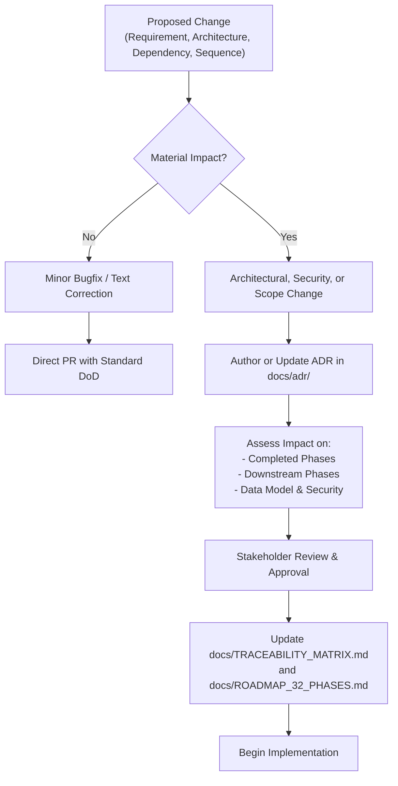

# Runstead — Definition of Done & Phase Exit Gate Standards

> **Project Name**: Runstead  
> **Sponsoring Organization**: Tonmoy Infrastructure  
> **Document Baseline**: Phase 0 (October 2026)  
> **Status**: Non-Negotiable Engineering Standard

---

## 1. Principles of Engineering Completion

In Runstead, **a feature or phase is never declared complete merely because implementation code has been written or a UI renders without visual errors**.

To maintain engineering credibility and prevent cumulative technical debt across all 32 development phases, every task, pull request, and phase exit must satisfy verifiable Definition of Done (DoD) criteria backed by reproducible evidence.

### Non-Fabrication Rule
- No developer, agent, or contributor may mark a requirement or phase as `Completed` or `Accepted` without direct, reproducible evidence (test logs, build output, or passing CI checks).
- Simulations and mockups must remain explicitly classified as `Simulated` or `Demo`.
- A failing required check or unfulfilled mandatory acceptance criterion prevents acceptance unless an explicit, documented exception is authorized by Tonmoy Infrastructure leadership.

---

## 2. Minimum Engineering Standard for Deliverables

Before any task or code change can be considered **Implementation Complete**, the following criteria must be satisfied:

```
┌─────────────────────────────────────────────────────────────┐
│             TASK LEVEL DEFINITION OF DONE                   │
├─────────────────────────────────────────────────────────────┤
│ 1. Acceptance Criteria Satisfied (Explicitly verified)      │
│ 2. Strict Type Check Passed (`npm run typecheck` = 0)       │
│ 3. Lint & Formatting Clean (`npm run lint` = 0 errors)      │
│ 4. Automated Tests Passing (Unit / Integration / E2E)       │
│ 5. Error Handling Implemented (Graceful client / server UX) │
│ 6. Observability Met (Structured errors and audit entries)  │
│ 7. Documentation Updated (Specs, README, ADRs)              │
│ 8. Security Boundaries Preserved (Zero secrets, RLS check)  │
│ 9. Rollback Considered (Safe forward or backward migration) │
│ 10. Peer Code Review Conducted                              │
└─────────────────────────────────────────────────────────────┘
```

1. **Acceptance Criteria Verification**: Every criterion specified in the requirements baseline must have an automated test asserting expected vs. actual behavior.
2. **Type Safety**: `npm run typecheck` (`tsc --noEmit`) must exit with code 0 under strict compiler flags.
3. **Linting Hygiene**: `npm run lint` (`next lint`) must exit with 0 errors. Any unavoidable framework warning must have an explicit technical rationale recorded.
4. **Automated Test Coverage**: New business workflows or calculation logic must include corresponding tests in `tests/*.test.ts` or `tests/e2e/*.spec.ts`.
5. **Robust Error Handling**: External API calls, JSON deserialization, and database queries must be wrapped in error boundaries returning standardized JSON error payloads. Unhandled Promise rejections are strictly prohibited.
6. **Security Review**: The change must not introduce credentials, hardcoded tokens, SQL injection vectors, or cross-tenant leakage pathways.
7. **Documentation Integrity**: Any changed interface, route, environment variable, or architectural pattern must be documented in the corresponding specification file under `docs/`.

---

## 3. Phase Exit-Gate Governance (6 Explicit States)

Every phase from **Phase 0 through Phase 31** is evaluated against an unambiguous phase lifecycle gate distinguishing six distinct operational states:

| Lifecycle State | Operational Definition | Entry Criteria | Exit Criteria |
| :--- | :--- | :--- | :--- |
| **Not started** | Work has not commenced. Prerequisites are pending or phase is scheduled for future delivery. | Previous phase not yet accepted. | Formal kickoff authorized. |
| **In progress** | Active development, specification, or testing is underway. | Prerequisites accepted. | All code and deliverables authored. |
| **Blocked** | Work is halted due to an external dependency, missing credential, or unapproved architectural decision. | Blocker recorded in Risk Register with ID. | Blocker resolved or authorized exception logged. |
| **Implementation complete** | All planned code, documentation, and configuration files have been written. Tests have not yet concluded. | Authoring completed. | Automated test suites executed. |
| **Verification complete** | All automated tests, static checks, builds, and peer reviews have executed and passed. | 100% test pass rate in CI. | Phase acceptance review initiated. |
| **Accepted** | Formal stakeholder sign-off confirming that all mandatory criteria, deliverables, and checks are satisfied with evidence. | Verification complete + audit checklist signed. | Advance to next phase kickoff. |

### The "No Stopping Early" Rule
A phase **cannot** be declared `Accepted` merely because development has stopped or because all documentation files have been created. Acceptance requires:
1. Every mandatory item in [`docs/phase-0/ACCEPTANCE_CHECKLIST.md`](file:///docs/phase-0/ACCEPTANCE_CHECKLIST.md) (or downstream phase equivalent) evaluated with an explicit evidence reference.
2. Reproduction of all validation commands on a clean working tree.
3. Formal recording of any remaining risks in [`docs/phase-0/RISK_REGISTER.md`](file:///docs/phase-0/RISK_REGISTER.md).

---

## 4. Cross-Phase Change Control Procedure

To prevent architectural drift and uncontrolled scope creep as development scales through Phase 31, all material changes must follow this lightweight change-control procedure:



### Change Control Triggers:
1. **Requirement Changes**: Modifying the scope, priority, or acceptance criteria of an existing `FR-*` or `NFR-*` requirement.
2. **Architectural Changes**: Introducing a new framework, persistence engine, caching layer, or message broker.
3. **Roadmap Reordering**: Modifying phase prerequisites or execution sequence.
4. **Third-Party Dependencies**: Adding any new npm dependency with non-zero transitive dependencies.
5. **Data Model Modifications**: Adding, dropping, or altering relational columns, foreign keys, or RLS policies.
6. **Security Boundaries**: Changing authentication algorithms, session lifetimes, or tenant isolation policies.
7. **Modifications to Completed Phases**: Any code modification touching a previously accepted phase must execute that phase's full test suite to guarantee zero regression.
